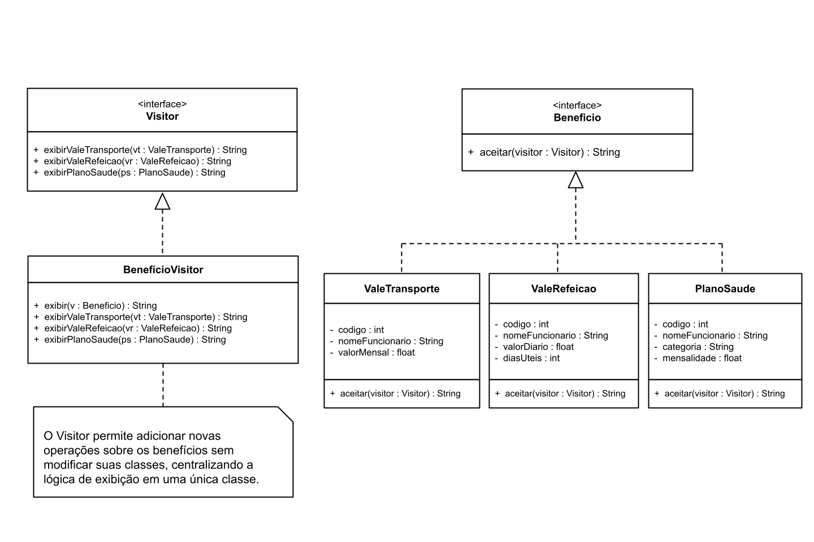

# Padrão de Projeto: Iterator (Sistema de Benefícios de RH)

**Disciplina:** DCC078-2026.3-A - Aspectos Avançados em Engenharia de Software

## Diagrama UML

O diagrama de classes do projeto está disponível em:

## Descrição

O padrão de projeto **Iterator (Iterador)** permite percorrer os elementos de uma coleção sem expor sua estrutura interna.

Neste projeto, o padrão foi aplicado a um sistema de benefícios de Recursos Humanos (RH), permitindo percorrer uma carteira de benefícios concedidos aos funcionários.

A implementação possibilita contabilizar os benefícios ativos e o total de benefícios cadastrados.

## Estrutura do Projeto

- **Beneficio:** representa um benefício concedido a um funcionário, contendo o nome do funcionário, o nome do benefício e sua situação (ativo ou inativo).
- **CarteiraBeneficios:** armazena os benefícios e implementa a interface `Iterable`, disponibilizando um iterador para percorrer a coleção.
- **RelatorioRH:** realiza a contagem dos benefícios ativos e do total de benefícios cadastrados, utilizando os mecanismos de iteração.

## Funcionamento

A classe `CarteiraBeneficios` implementa `Iterable`, permitindo percorrer seus elementos de diferentes maneiras.

A classe `RelatorioRH` utiliza duas formas de iteração:

- **For-each:** percorre os benefícios para contabilizar somente aqueles que estão ativos.
- **Iterator:** utiliza os métodos `hasNext()` e `next()` para percorrer a coleção e contabilizar todos os benefícios.

Dessa forma, a coleção pode ser percorrida sem que a classe responsável pelo relatório precise conhecer sua implementação interna.

## Testes

Os testes foram implementados utilizando **JUnit 5**, verificando as duas operações disponíveis:

1. `deveContarBeneficiosAtivos()` – verifica a quantidade de benefícios ativos na carteira.
2. `deveContarTotalBeneficios()` – verifica a quantidade total de benefícios cadastrados.

**Total: 2 casos de teste.**